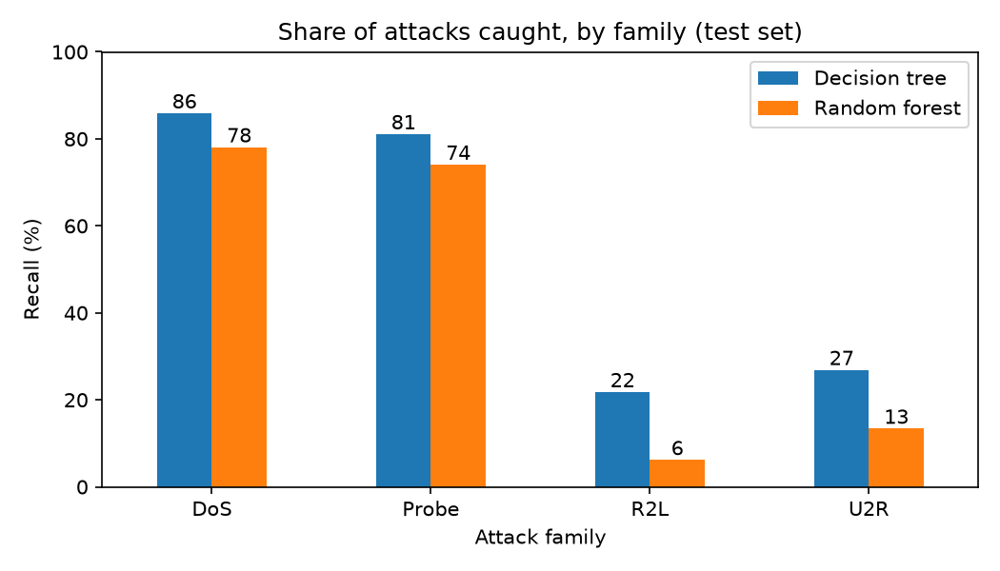
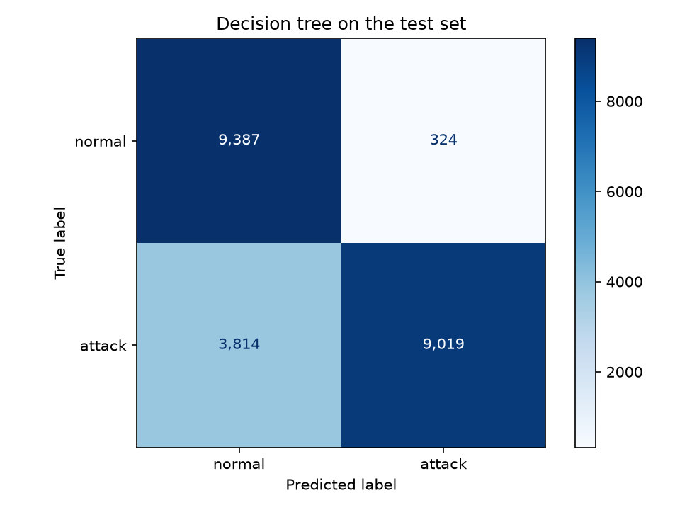

# Detecting Malicious Network Connections with Python

I built a detector that labels each network connection as **normal** or **attack**, then investigated where it fails and why. The project uses Python (pandas, scikit-learn, matplotlib) and the NSL-KDD intrusion detection dataset.

## Key findings

| Approach | Test accuracy | Alerts that were real attacks (precision) | Attacks caught (recall) | Unseen attack types caught |
|---|---|---|---|---|
| One-line rule: `flag != 'SF'` | 76.2% | 98.6% | 58.9% | 57.4% |
| **Decision tree** | **81.6%** | 96.5% | **70.3%** | 43.4% |
| Random forest | 76.5% | 96.7% | 60.9% | 21.7% |

1. **One rule already catches most of the loud attacks.** Flagging every connection that didn't complete normally (TCP flag other than `SF`) gives 76% accuracy. Floods and scans give themselves away through abnormal connection states.
2. **The decision tree is the best overall, with few false alarms.** It wrongly flagged only 324 of 9,711 normal connections (3.3%).
3. **Quiet attacks get through.** The tree caught 86% of DoS and 81% of Probe attacks, but only 22% of R2L and 27% of U2R attacks. Those two families are under 1% of the training data (995 and 52 of 125,973 rows), so the model barely learned what they look like.
4. **New attack types are the biggest blind spot.** 3,750 of the 12,833 test attacks (29%) are types that never appear in training. The tree caught 81% of known attack types but only 43% of new ones.
5. **A more powerful model did worse on new attacks.** The random forest caught only 22% of unseen attack types, half the tree's rate. Fitting past attacks more closely made it worse at spotting new ones. The simple rule caught the most (57%), because it looks for abnormal behaviour rather than the shape of past attacks.
6. **The tree leans on one feature.** `src_bytes` (bytes sent by the source) accounts for 74% of its feature importance. That likely explains why new attacks with different traffic sizes slip past it.





## Why it matters

The noisy attacks are easy to spot because there are so many of them. The dangerous ones, such as password guessing, privilege escalation and rootkits, are quiet and scarce. A detector trained on labelled past attacks learns yesterday's attacks. That's why real security operations pair it with behaviour-based rules and anomaly detection.

## Dataset

I'd like to acknowledge the NSL-KDD dataset and the paper by Tavallaee, Bagheri, Lu and Ghorbani (2009) [1] for making the `KDDTrain+` and `KDDTest+` files available. I retrieved the files from https://github.com/jmnwong/NSL-KDD-Dataset on 17/06/2026.

- **Train:** 125,973 connections. **Test:** 22,544 connections.
- 41 traffic features per connection, plus the attack name (`label`) and a `difficulty` score added by the authors.
- NSL-KDD is a cleaned-up version of KDD Cup 99, with duplicate records removed so a model can't score well by memorising repeats.

## How I did it, step by step

The notebook (`notebook/nsl-kdd-analysis.ipynb`) shows every command and its output. Below are the steps, the reason for each, and the checkpoint I used to confirm it worked.

### Phase 0: Setup

1. Created a virtual environment (`python -m venv venv`) and activated it (`venv\Scripts\activate.bat` on Windows), so the project's packages stay separate from the rest of my computer.
2. Installed the tools: `pip install pandas numpy matplotlib seaborn scikit-learn jupyter`.
3. Froze the versions while the environment was clean: `pip freeze > requirements.txt`. Anyone can now rebuild the same setup.
4. Launched Jupyter from inside the venv and checked the wiring: `import pandas as pd; print(pd.__version__)` printed the venv's pandas version (3.0.x).

### Phase 1: Load and understand

1. The data files are comma-separated text with **no header row**, so I loaded them with `header=None` and supplied the 43 column names myself. *Checkpoint:* `train.shape` → `(125973, 43)`.
2. `train['label'].value_counts()` showed 67,343 normal connections. The most common attack is `neptune` (41,214), a SYN-flood DoS attack.
3. Created the target column with `(train['label'] != 'normal').astype(int)`: `!=` gives True for every attack, and `.astype(int)` turns True/False into 1/0. *Checkpoint:* 0 → 67,343, 1 → 58,630.
4. Mapped the 22 attack names to four families with a dictionary and `.map()`:
   - **DoS** (denial of service) floods a target. **Probe** scans the network. Both are loud and high-volume, which is what features like `count`, `srv_count` and `serror_rate` are built to capture.
   - **R2L** (remote to local) and **U2R** (user to root) are quiet: often a single connection, with the harm hidden in the payload. That's why features like `num_failed_logins`, `root_shell` and `hot` exist.
5. **Bug I hit:** my first dictionary was written backwards (families as keys, attack names as values). `.map()` looks values up by key, so every attack became NaN. `value_counts(dropna=False)` exposed it as 58,630 NaN rows. Without `dropna=False`, `value_counts()` hides NaN and I would have missed the problem. Lesson: `.map()` fails quietly, so check loudly. *Checkpoint after the fix:* normal 67,343, DoS 45,927, Probe 11,656, R2L 995, U2R 52.

### Phase 2: Clean

1. Confirmed there are no missing values and no duplicate rows.
2. Looked for columns that never change. `num_outbound_cmds` is 0 in every row. `value_counts()` only showed the column was full, but `describe()` showed min = max = 0. It carries no information, so I dropped it. *Checkpoint:* `(125973, 44)`, which is 43 + 2 new columns − 1 dropped.
3. Counted the categories in the three text columns: `protocol_type` 3, `flag` 11, `service` 70. A model needs numbers, so these must be encoded.

### Phase 3: Explore

1. Checked what share of each TCP connection flag is attacks. 99% of `S0` connections (connection attempted, no reply) are attacks, and 76% of `REJ` (rejected), but only 15% of `SF` (normal, completed). That became the idea for the rule baseline.
2. Plotted rows per attack family on a log scale. It makes the imbalance obvious: R2L and U2R are tiny next to DoS.

### Phase 4: Prepare the test set the same way

1. Loaded `KDDTest+.txt` and created `target` the same way. *Checkpoint:* 1 → 12,833, 0 → 9,711.
2. Mapping the families gave **3,750 NaN rows**: 17 attack types that exist only in the test file. I listed them with `test.loc[test['attack_category'].isna(), 'label'].value_counts()` and added them to the dictionary with the standard NSL-KDD grouping. `httptunnel` is grouped under R2L here, although some papers put it under U2R. *Checkpoint:* no NaN, with normal 9,711, DoS 7,458, R2L 2,887, Probe 2,421, U2R 67.
3. Dropped `num_outbound_cmds` from the test set too, since it's all zeros there as well.

### Phase 5: Encode the text columns

1. One-hot encoded `protocol_type`, `flag` and `service` with `pd.get_dummies`, so each category became its own True/False column. Train went from 44 to 125 columns (44 − 3 + 84). `service` alone adds 70 columns, which is acceptable for tree models with 125,973 rows.
2. Test only had 119 columns, because some services never appear in it. `reindex(columns=train_encoded.columns, fill_value=0)` gave test exactly train's columns in the same order. A model reads columns by position, so a mismatch would make its predictions meaningless. *Checkpoint:* `list(train_encoded.columns) == list(test_encoded.columns)` → True.
3. Checked that every row has exactly one True per original column (one protocol, one flag and one service per connection).

### Phase 6: Split features from the target

Removed four columns from the features: `target` (the answer), `label` and `attack_category` (the answer in other words, which would be **data leakage**) and `difficulty` (metadata added by the authors, not traffic). *Checkpoint:* 121 features in both train and test, all numeric or True/False.

### Phase 7: Rule baseline

Before any machine learning: predict "attack" whenever `flag` is not `SF`. Result: 76.2% accuracy, 98.6% precision, 58.9% recall.

### Phase 8: Decision tree

Trained `DecisionTreeClassifier(random_state=42)`. Train accuracy was 99.99% and test accuracy 81.6%. The gap shows the tree memorised the training data, and the test set contains attacks it has never seen.

### Phase 9: Random forest

Trained 100 trees with `class_weight='balanced'`. Test accuracy dropped to 76.5%. I also learned why balancing didn't help: attack vs normal is already close to even in training (58,630 vs 67,343). The real imbalance is *between attack families* (R2L has 995 rows against DoS's 45,927), and balancing the two top-level classes doesn't touch it.

### Phase 10: Where the models fail

For attack rows, a prediction is 1 when caught and 0 when missed, so the average prediction per group is the share caught. I grouped the results by attack family and by whether the attack type appears in training. The results are in **Key findings** above.

## Limitations

- **Old data.** NSL-KDD is derived from 1998 DARPA traffic. Modern networks (encrypted traffic, cloud services) look very different.
- **Binary only.** The models predict attack vs normal, not which family.
- **Default settings.** No tuning, and a single random seed.
- **No separate validation set.** I compared models on the test set, which is fine for learning but optimistic for a real evaluation.

## What I'd try next

- Limit the tree's depth (`max_depth`) to reduce memorisation, and test whether it catches more new attack types.
- Combine the rule and the tree (alert if either fires) and measure the precision trade-off.
- Train on the four families, and oversample R2L and U2R.
- Try anomaly detection (for example, Isolation Forest trained on normal traffic only), which doesn't need examples of every attack.
- Repeat the analysis on a modern dataset such as CIC-IDS2017 or UNSW-NB15.

## How to run

```bash
git clone https://github.com/<arturkats@live.com>/nsl-kdd-ids.git
cd nsl-kdd-ids
python -m venv venv
venv\Scripts\activate            # Windows  (macOS/Linux: source venv/bin/activate)
pip install -r requirements.txt
jupyter lab                      # open notebook/nsl-kdd-analysis.ipynb, then Run > Run All Cells
```

The data files go in `data/`. The charts are saved to `images/` when the notebook runs.

## Repository structure

```
nsl-kdd-ids/
├── data/                  # KDDTrain+.txt, KDDTest+.txt
├── notebook/              # nsl-kdd-analysis.ipynb
├── images/                # charts used in this README
├── README.md
└── requirements.txt
```

## References

[1] M. Tavallaee, E. Bagheri, W. Lu and A. A. Ghorbani, "A Detailed Analysis of the KDD CUP 99 Data Set," *Proceedings of the 2009 IEEE Symposium on Computational Intelligence for Security and Defense Applications (CISDA)*, 2009.
